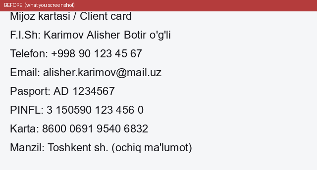

<div align="center">

# 🛡️ PiiBlur

**Automatically blur personal data in your screenshots — before you paste them into ChatGPT, Telegram, or anywhere else.**

100% local · free · open-source · Windows 10/11



</div>

---

Take a screenshot (`Win+Shift+S` or `PrtSc`). PiiBlur sits quietly in the tray,
notices the new image, blurs any personal data in it, and puts the clean version
back on your clipboard. You only notice it on `Ctrl+V` — what you paste is already
clean. **Nothing ever leaves your computer.**

## Why

Everyone screenshots things into AI chats now — and screenshots leak more than you
think: phone numbers, card numbers, passport/ID numbers, emails, names, IP
addresses. Once it's pasted into a cloud AI (or posted online), it's out of your
hands. PiiBlur removes that data on the way out, automatically.

## What it blurs

Detection is tuned to catch identifiers with a **distinctive shape** (so it almost
never blurs ordinary numbers by mistake):

| Category | Examples |
|---|---|
| **Cards** | Visa / Mastercard / Amex / UzCard / Humo (Luhn-checked) |
| **Phones** | 🇺🇿 `+998…`, 🇷🇺 `+7…`, and international `+<country>…` |
| **National IDs** | 🇺🇿 PINFL, passport series · 🇷🇺 SNILS, passport · 🇺🇸 SSN |
| **Banking** | IBAN |
| **Online** | email, IPv4 |
| **Names** | Uzbek (`Familiya Ism … o'g'li/qizi`) & Russian (`Фамилия Имя Отчество`) |

Structured identifiers are rock-solid; **names are a fuzzy, optional pass** (toggle
in settings). More countries are easy to add — PRs welcome.

## Install

1. Download **`PiiBlur_Setup.exe`** from [Releases](../../releases).
2. Run it (per-user, no admin needed). It installs to `%LocalAppData%\PiiBlur`.
3. It starts in the tray and runs with Windows from then on.

> **Windows SmartScreen** may show "unknown publisher" (the app isn't code-signed
> yet). Click **More info → Run anyway**. It's open-source — read the code here.

## Use

- `Win+Shift+S` → select → `Ctrl+V` into any app. Done.
- Tray menu: **Settings** (auto mode, blur names, blur strength, start with Windows),
  **Pause**, **Quit**.
- Safety net: you still see the image in the target app's preview (e.g. Telegram)
  before sending — so a rare miss is visible before anything leaves.

## How it works

```
clipboard image → OCR (RapidOCR, on-device) → detect PII (per line) → blur → clipboard
```

The accuracy trick: detection runs at the **line level** — it joins a line's OCR
words, matches patterns on the joined text, then maps each hit back to exact pixel
boxes. That keeps values OCR split across words (a spaced phone, a grouped card)
whole and blurs them tightly.

## Privacy

Everything runs **on your machine** — OCR, detection, blurring. No network calls,
no telemetry. The only file it writes is your settings at
`%APPDATA%\PiiBlur\config.json`.

## ⚠️ Disclaimer

PiiBlur is **best-effort, not a guarantee.** It can miss things (especially names,
unusual formats, low-quality text) or occasionally over-blur. **Always check the
image in your target app's preview before you send it.** Do not rely on it as your
only safeguard for sensitive data. Provided "as is", without warranty — see
[LICENSE](LICENSE).

## Troubleshooting

PiiBlur is built to **fail quietly, never crash in your face**: any error is written
to `%APPDATA%\PiiBlur\logs\crash.log` and (for a startup failure) shown as one clean
dialog, not a raw traceback. If something's off:

| Symptom | Cause / fix |
|---|---|
| Nothing happens on `Ctrl+V` | Check the tray icon is running (green = active). Open `crash.log`. |
| "DLL load failed" on launch | Install the [Microsoft Visual C++ Redistributable (x64)](https://aka.ms/vs/17/release/vc_redist.x64.exe). The MSVC runtime ships with the app, but a very old/clean system may still need it. |
| Instant close on a very old PC (pre-2013) | The OCR engine needs a CPU with AVX. Nothing to fix on such hardware yet. |
| Clipboard sometimes skipped | Another app held the clipboard; PiiBlur retries automatically — just copy again. |
| Two tray icons | Shouldn't happen (single-instance lock); if it does, quit both and relaunch. |

Hardened against the common real-world crashes: uncaught exceptions, missing VC++
runtime, clipboard "access denied", double launch, and long install paths.

## Build from source

```bash
python -m venv .venv && .venv\Scripts\activate
pip install -r requirements.txt
python -m pii_blur.tray         # run from source
pytest -q                       # 14,000+ generated tests
python build.py                 # -> installer_output\PiiBlur_Setup.exe
```

## Names: a hybrid

Names are the hard part, so PiiBlur blurs them with a **hybrid** (each layer covers
the others' blind spots):

- **Gazetteer + rules** — a list of common Uzbek/Russian given names plus
  surname-suffix rules (`-ov/-ova`, `o'g'li/qizi`). Rock-solid on known names and
  the only layer that reads **Cyrillic**.
- **A small neural model** — a 64 MB int8 BERT NER fine-tuned for Uzbek (Latin),
  which generalizes to names *not* in any list (unlisted surnames, lowercase
  handles). This is what lets it scale beyond a hand-list.
- **A fixed-UI stoplist** — drops the model's characteristic false positives on app
  chrome (status badges, menu labels).

On held-out, *unseen* names from real screenshots this roughly doubles the
gazetteer-only recall (≈42% → ≈84%) while keeping false positives near zero.
Toggle the model off in Settings for a lighter, faster, gazetteer-only run.

## Tech

Python · RapidOCR (ONNX, CPU) · OpenCV (YuNet face detection) · ONNX NER model +
tokenizers · Pillow · pywin32 · pystray · tkinter · PyInstaller + Inno Setup.
Detection + blur are pure Pillow/stdlib and fully unit-tested (structured PII:
100% recall, 0% false-positives on the generated suite).

## License & credits

[GPLv3](LICENSE). Free and open; forks stay open.

Bundled third-party assets:

- **Face detection** — [YuNet](https://github.com/opencv/opencv_zoo/tree/main/models/face_detection_yunet)
  (`assets/face_detection_yunet.onnx`, ~230 KB) by Shiqi Yu, OpenCV Zoo,
  [MIT License](assets/YUNET_LICENSE.txt).
- **Name model** — a BERT NER fine-tuned by this project on public Uzbek NER data,
  on top of [TahrirchiBERT-small](https://huggingface.co/tahrirchi/tahrirchi-bert-small) (Apache-2.0).
- **Uzbek names list** (`pii_blur/data/uz_names.txt`) — derived from the name
  gazetteer published with the open-access *Data in Brief* dataset accompanying
  "A Hybrid NER–Sentiment Model for Uzbek Texts" (CC BY); cleaned to drop
  OCR-garbled entries.
